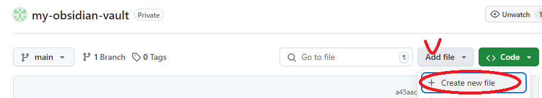
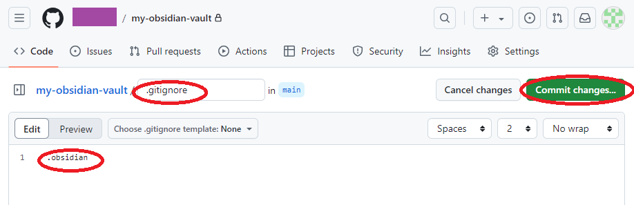
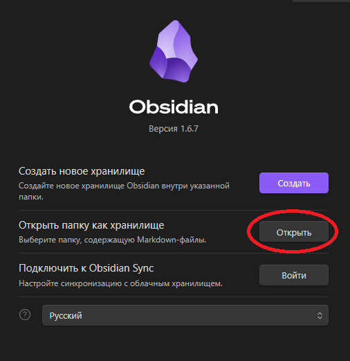
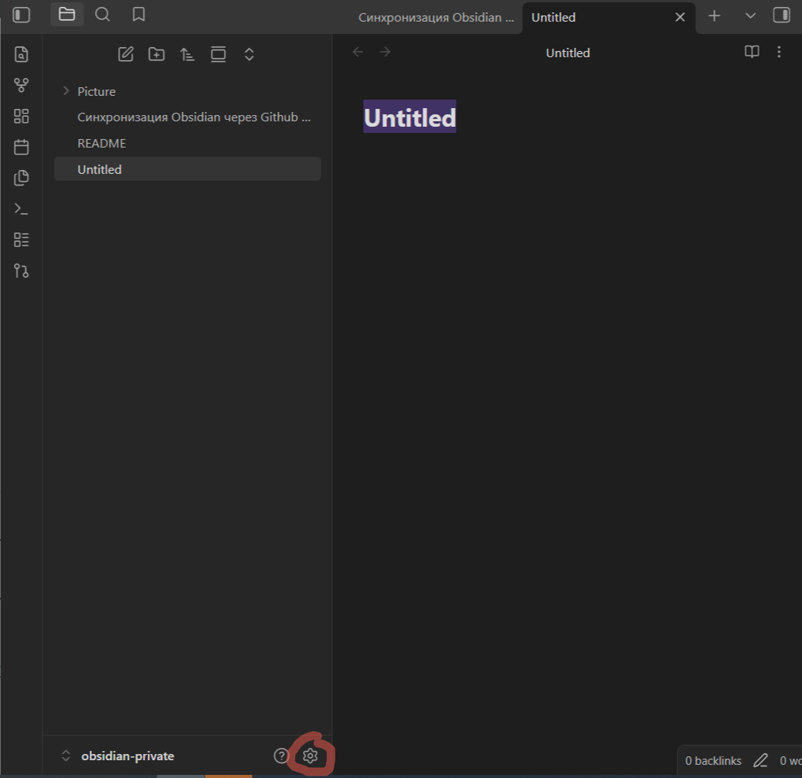
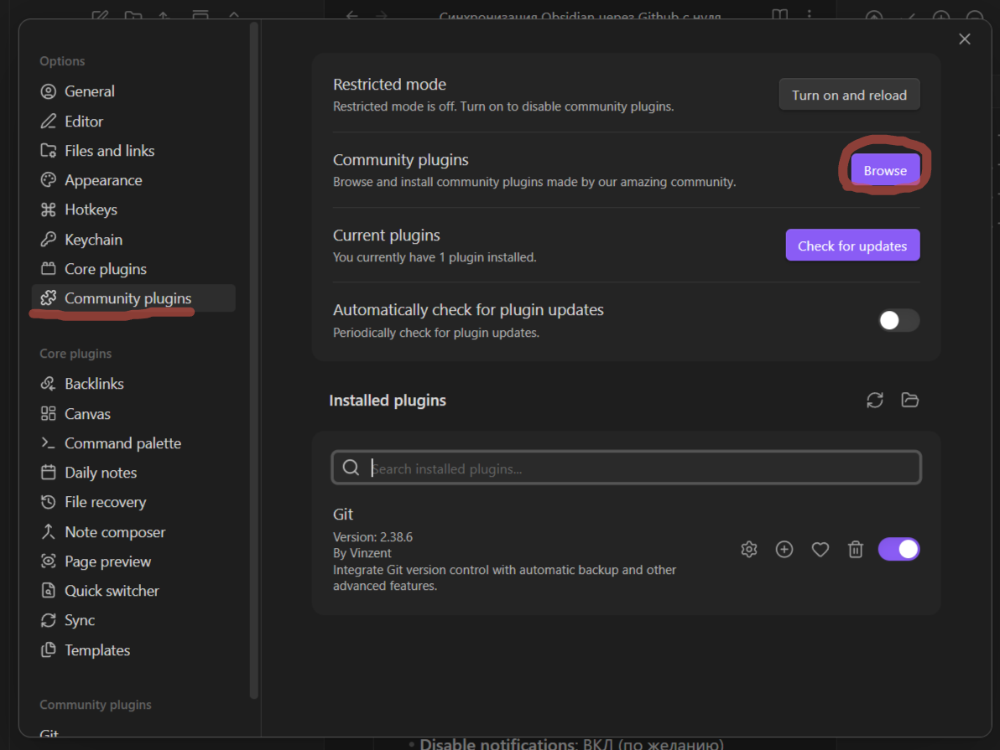
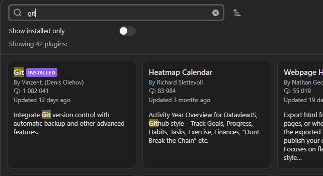
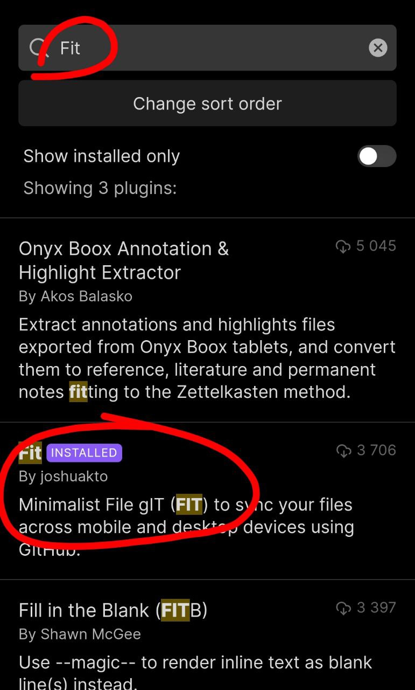

# 🔄 Синхронизация Obsidian через GitHub

Бесплатная синхронизация заметок Obsidian между компьютером и телефоном через GitHub — без Notion, iCloud и платных сервисов синхронизации.

> [!NOTE]
> **Для новичка:** выполняйте шаги по порядку. На компьютере нужно один раз выполнить несколько команд; ниже объясняется, где нажимать и что вводить.

## Что понадобится

- [ ] Компьютер с Windows
- [ ] Телефон (Android или iOS)
- [ ] Аккаунт на [GitHub](https://github.com/) (бесплатный)
- [ ] Установленный [Obsidian](https://obsidian.md/download)

> [!WARNING]
> **Главное правило:** никогда не редактируйте один и тот же файл одновременно на компьютере и телефоне — это приведёт к конфликту или потере данных.

## Содержание

- [Шаг 1. Создаём репозиторий на GitHub](#шаг-1-создаём-репозиторий-на-github)
- [Шаг 2. Настраиваем безопасную авторизацию](#шаг-2-настраиваем-безопасную-авторизацию)
- [Шаг 3. Настраиваем компьютер](#шаг-3-настраиваем-компьютер-windows)
- [Шаг 4. Настраиваем телефон](#шаг-4-настраиваем-телефон)
- [Если возник конфликт](#если-возник-конфликт)
- [Частые вопросы](#частые-вопросы)

---
## Шаг 1. Создаём репозиторий на GitHub

Репозиторий — это «облачная папка» на GitHub, куда будут сохраняться ваши заметки.

1. Зарегистрируйтесь или войдите на [github.com](https://github.com/)
2. Откройте страницу [создания репозитория](https://github.com/new)
3. В поле **Repository name** введите название латиницей (например, `my-obsidian-vault`)
4. Настройте параметры:
   - **Visibility** → `Private` (репозиторий не будет публичным; доступ останется у вас и у тех, кому вы его отдельно предоставите)
   - **Add README** → включить
5. Нажмите зелёную кнопку **Create repository**

   
   **Проверьте приватность:** рядом с названием репозитория должно быть указано **Private**. Если репозиторий уже создан как Public, откройте **Settings → General → Danger Zone → Change visibility → Make private** и следуйте подсказкам GitHub.

   Официальная справка: [Setting repository visibility](https://docs.github.com/en/repositories/managing-your-repositorys-settings-and-features/managing-repository-settings/setting-repository-visibility).

Добавьте в репозиторий ещё один файл — `.gitignore`:

6. В репозитории нажмите «добавить файл»

   

7. Назовите файл `.gitignore` и впишите внутрь одну строку:
   ```
   .obsidian
   ```

   

> [!TIP]
> **Зачем нужен `.gitignore`:** папка `.obsidian` хранит настройки приложения и плагинов. В этой инструкции она исключается из Git, чтобы локальные настройки устройств не смешивались. `.gitignore` не обязателен для работы Git; если вы хотите синхронизировать отдельные настройки, сначала проверьте, что именно в них хранится.

---
## Шаг 2. Настраиваем безопасную авторизацию

На компьютере и телефоне используются разные способы авторизации:

- **Компьютер с Windows:** Git Credential Manager (GCM). Токен вручную создавать и вставлять не нужно.
- **Телефон:** плагину Fit нужен токен GitHub. Мы создадим отдельный токен только для вашего репозитория и с ограниченным сроком действия.

### 2.1 Компьютер: авторизация через браузер

1. Установите актуальную версию [Git for Windows](https://git-scm.com/downloads/win). В установщике оставьте настройки по умолчанию и не отключайте Git Credential Manager.
2. При первом клонировании приватного репозитория Git предложит пройти авторизацию. Может появиться окно браузера или предложение открыть его.
3. В браузере войдите в свой GitHub-аккаунт и подтвердите авторизацию, если появится такой запрос.
4. Вернитесь в терминал и дождитесь завершения операции. В дальнейшем GCM будет использовать сохранённые учётные данные Windows, поэтому токен не нужно вставлять вручную.

Официальная справка: [GitHub Docs — Caching your GitHub credentials in Git](https://docs.github.com/en/get-started/git-basics/caching-your-github-credentials-in-git?platform=windows).

### 2.2 Телефон: создаём токен для плагина Fit

1. На телефоне откройте [страницу создания fine-grained personal access token](https://github.com/settings/personal-access-tokens/new) и войдите в GitHub, если потребуется.
2. В поле Token name укажите название, например **Obsidian Fit mobile sync**.
3. В поле Expiration выберите ограниченный срок действия, который сможете отслеживать. После его окончания мобильная синхронизация потребует новый токен.
4. В разделе Repository access выберите **Only select repositories**, затем отметьте только репозиторий Obsidian-хранилища.
5. В разделе Repository permissions установите для **Contents** значение **Read and write**. Другие права не добавляйте. Если GitHub показывает **Metadata: Read-only**, оставьте его.
6. Нажмите **Generate token** и сразу скопируйте токен. Полный токен показывается только при создании.
7. Не отправляйте токен себе в чат и не сохраняйте его в заметке. Сразу вставьте его в настройки Fit на телефоне, как описано в шаге 4.

> [!CAUTION]
> Токен — это секрет, похожий на пароль. Не помещайте его в URL репозитория, команды терминала, файлы Markdown, скриншоты или сообщения. Токен даёт возможность читать и изменять выбранный репозиторий. Если он случайно раскрыт, отзовите его в [настройках GitHub](https://github.com/settings/personal-access-tokens) и создайте новый.

> [!TIP]
> Удобнее создать токен на том же телефоне, где настроен Fit, чтобы не пересылать его между устройствами.

---
## Шаг 3. Настраиваем компьютер Windows

### 3.1 Устанавливаем Git

1. Скачайте и установите [Git for Windows](https://git-scm.com/downloads/win). Оставьте стандартные параметры установки и не отключайте Git Credential Manager.
2. Откройте программу **Git Bash**
3. Представьтесь Git — введите команды по очереди, заменив данные на свои:
   ```bash
   git config --global user.name "Имя Фамилия"
   git config --global user.email "ваш_email"
   ```
   Проверить, что всё сохранилось, можно так:
   ```bash
   git config --global user.name
   git config --global user.email
   ```
   Команды должны показать введённые вами данные.

### 3.2 Скачиваем репозиторий на компьютер

1. Откройте свой репозиторий на GitHub.
2. Нажмите зелёную кнопку **Code**, выберите вкладку **HTTPS** и нажмите значок копирования рядом с адресом. Адрес должен выглядеть примерно так:

   ~~~text
   https://github.com/ИМЯ_ПОЛЬЗОВАТЕЛЯ/НАЗВАНИЕ_РЕПОЗИТОРИЯ.git
   ~~~

   Копируйте адрес из GitHub. Не добавляйте к нему токен или пароль.
3. Создайте папку для хранилища Obsidian в удобном месте на диске.
4. Откройте Git Bash, PowerShell или CMD **обычным пользователем**. Запуск от имени администратора не нужен.
5. В терминале перейдите в папку, внутри которой должна появиться папка репозитория. Например:

   ~~~bash
   cd C:\Полный\Путь
   ~~~

   Чтобы перейти на другой диск в CMD, введите его букву, например D:. Команда cd с двумя точками поднимает на уровень выше.
6. Введите команду git clone, затем через пробел вставьте скопированный HTTPS-адрес и нажмите Enter. Пример:

   ~~~bash
   git clone https://github.com/ИМЯ_ПОЛЬЗОВАТЕЛЯ/НАЗВАНИЕ_РЕПОЗИТОРИЯ.git
   ~~~

   Замените пример адресом, скопированным на шаге 2.
7. При первом обращении к приватному репозиторию Git Credential Manager предложит войти в GitHub через браузер. Пройдите авторизацию и дождитесь окончания клонирования. Вставлять токен в команду не нужно.
8. Появится локальная папка с файлами репозитория — её и нужно открыть в Obsidian.

> [!TIP]
> Уже есть заметки в Obsidian? Сначала клонируйте репозиторий в отдельную папку, затем перенесите заметки после проверки структуры. Не клонируйте репозиторий поверх действующего хранилища.

### 3.3 Открываем хранилище в Obsidian

1. Откройте Obsidian → **«Открыть папку как хранилище»**
2. Выберите скачанную папку

   

### 3.4 Включаем автосинхронизацию (плагин Git)

1. В Obsidian: **Настройки → Community plugins** → найдите и установите плагин **Git**

   
   
   

2. В настройках плагина включите:
   - **Vault Backup Interval (minutes)** → `1`
   - **Auto Backup after stopping file edits** → ✅ Вкл
   - **Pull updates on startup** → ✅ Вкл
   - **Disable notifications** → по желанию

> [!TIP]
> Готово! Плагин будет выполнять backup/sync по выбранным настройкам. Проверьте первую синхронизацию вручную и не считайте автоматизацию заменой контроля конфликтов. Синхронизировать вручную можно командой `Git: Create backup` (`Ctrl+P` → `git b`).

---
## Шаг 4. Настраиваем телефон

Перед началом выполните шаг 2.2 и создайте отдельный fine-grained токен для своего репозитория.

1. Откройте Obsidian на телефоне и создайте новое **пустое** хранилище. Так файлы из GitHub не смешаются с другими заметками.
2. Откройте **Настройки → Community plugins**, найдите, установите и включите плагин **Fit**.

   

3. Откройте настройки Fit и заполните параметры:
   - **GitHub Token** → вставьте созданный токен.
   - Нажмите **Authenticate user** и дождитесь авторизации.
   - **GitHub repository name** → выберите свой репозиторий в появившемся списке.
   - **Branch name** → main.
   - **Auto sync** → Muted, если хотите автоматическую синхронизацию без лишних уведомлений.
   - **Auto check interval** → 1 минута, если такой параметр есть в вашей версии плагина.
   - Уведомления об изменении файлов → выключите по желанию.
4. На телефоне проведите пальцем вниз по экрану, чтобы открыть меню команд. Найдите **Fit: Fit Sync** и нажмите команду. Дождитесь окончания синхронизации. Альтернатива: добавьте команду **Fit Sync** на боковую панель Obsidian.
5. Проверьте результат: откройте репозиторий на GitHub и убедитесь, что заметки появились. Затем создайте тестовую заметку на телефоне и синхронизируйте её; проверьте, что она появилась на компьютере.

> [!WARNING]
> Не отправляйте токен себе в чат, не сохраняйте его в заметке и не делайте скриншот поля с токеном. Если токен раскрыт или истёк, отзовите/создайте новый и повторите авторизацию в Fit.

---
## Если возник конфликт

Возникает, если файл был изменён на двух устройствах одновременно.

- **На компьютере:** откройте файл — git пометит конфликтующие места. Отредактируйте вручную и уберите лишнее. Если правки были в разных частях файла, git часто объединяет их автоматически.
- **На телефоне:** файл не перезаписывается — «внешняя» версия сохраняется в отдельную папку `_fit`. Сравните версии вручную и решите, что оставить.

---
## Частые вопросы

**Можно обойтись только телефоном?**
Да, если выбранный мобильный плагин поддерживает нужные операции. В этом случае компьютерный шаг можно пропустить, но работа с историей и восстановлением версий будет менее удобной.

**Можно синхронизировать несколько хранилищ?**
Да, заведите под каждое свой репозиторий и повторите настройку отдельно.

**Как посмотреть историю изменений заметки?**
На сайте GitHub откройте нужный файл в репозитории и нажмите кнопку **History**.

**А если GitHub заблокирован?**
Варианты: Termux на Android, iCloud на iOS, другие open-source Git-сервисы, либо платная синхронизация от самого Obsidian.

---
## Источник 

Инструкция составлена на основе идеи из статьи [Habr — Obsidian+Github вместо Notion](https://habr.com/ru/articles/843288/).
